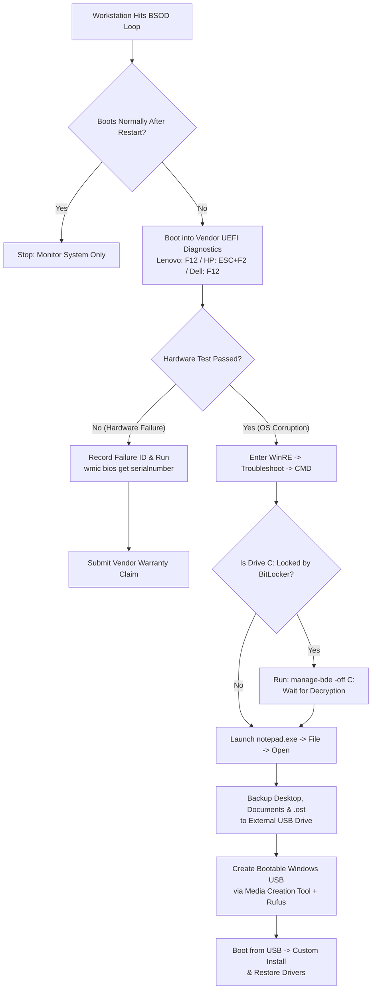

#  Windows BSOD & BitLocker Disaster Recovery Runbook

A comprehensive, step-by-step IT disaster recovery and hardware diagnostics manual designed to help both technical staff and non-technical end users triage Windows Blue Screen of Death (BSOD) boot loops, extract locked user data, manage BitLocker encryption via WinRE, and perform clean OS reinstallations across enterprise laptop vendors.

> ** Safety & Data Integrity Notice:**  
> * If a workstation restarts after a one-time BSOD and boots normally into Windows, **do not** execute the manual recovery steps below.
> * Always back up critical user data to an external drive before modifying partitions or reinstalling the operating system.

---

##  Table of Contents
1. [Multi-Vendor Hardware Diagnostics (UEFI)](#1-multi-vendor-hardware-diagnostics-uefi)
2. [Retrieving Serial Numbers & Checking Warranty](#2-retrieving-serial-numbers--checking-warranty)
3. [Emergency Data Extraction via WinRE (`notepad.exe`)](#3-emergency-data-extraction-via-winre-notepadexe)
4. [Disabling BitLocker Encryption via CLI](#4-disabling-bitlocker-encryption-via-cli)
5. [Creating a Bootable Windows Installation USB](#5-creating-a-bootable-windows-installation-usb)
6. [Clean Windows OS Reinstallation](#6-clean-windows-os-reinstallation)

## 🔄 Disaster Recovery Decision Flowchart




---

## 1. Multi-Vendor Hardware Diagnostics (UEFI)

Before reinstalling Windows, run built-in UEFI hardware diagnostics to rule out failing SSDs, RAM, or motherboards.

| Manufacturer | Boot / Diagnostics Key | Navigation Steps |
| :--- | :--- | :--- |
| **Lenovo** | Repeatedly press **`F12`** at power-on | Select **Lenovo Diagnostics UEFI** → Press **`S`**, **`E`**, **`U`** or select **Run All** extended checks. |
| **HP** | Hold power 5s to shut down → Power on and repeatedly press **`ESC`**, then **`F2`** | Open **HP PC Hardware Diagnostics (UEFI)** → **System Tests** → **Extensive Test** (or run the *Symptoms Test* if hardware passes). |
| **Dell** | Repeatedly press **`F12`** at the Dell logo | Open **One-Time Boot Menu** → Select **Diagnostics** (ePSA / SupportAssist On-board Diagnostics). |

* **If any hardware test fails:** Record the failure ID/QR code, retrieve the device serial number (Section 2), and initiate a vendor warranty claim.
* **If all hardware checks pass but Windows still fails to boot:** Proceed to **Section 3** to rescue user data before reinstalling Windows.

---

## 2. Retrieving Serial Numbers & Checking Warranty

### Option A: Inside Windows (If Bootable)
1. Press **`Win + R`**, type `cmd`, and press **`Enter`**.
2. Run:
   ```cmd
   wmic bios get serialnumber
   ```
   *(Note: Dell refers to the Serial Number as the **Service Tag**)*.

### Option B: Locked Out of Windows (Via WinRE)
1. On the Windows Automatic Repair screen, select **Troubleshoot** → **Advanced Options** → **Command Prompt**.
2. Run `wmic bios get serialnumber` to retrieve the hardware ID offline.

### Official Vendor Warranty Portals
* **Lenovo:** [://lenovo.com](https://://lenovo.com#/)
* **HP:** [://hp.com](https://://hp.com)
* **Dell:** [://dell.com](https://www.://dell.com/)

---

## 3. Emergency Data Extraction via WinRE (`notepad.exe`)

When Windows cannot boot into the desktop, you can launch `notepad.exe` inside the Windows Recovery Environment (WinRE) to act as a lightweight graphical file browser for backing up user data.

### Prerequisites
* An external USB hard drive or SSD with sufficient storage capacity.
* Connect the laptop to AC power (large data transfers can take several hours).

### Step-by-Step Extraction
1. Boot into Windows Automatic Repair and navigate to **Troubleshoot** → **Advanced Options** → **Command Prompt**.
2. Switch to the main system drive (usually `C:`, though drive letters may shift in WinRE):
   ```cmd
   C:
   ```
   *(If access is denied due to **BitLocker**, complete **Section 4** first, then return here)*.
3. Launch Notepad from the command line:
   ```cmd
   notepad.exe
   ```
4. Inside Notepad, click **File** → **Open**.
5. Change the file filter at the bottom-right from `Text Documents (*.txt)` to **`All Files (*.*)`**, then click **This PC**.
6. Navigate to critical user directories and copy them to your external drive:
   * `C:\Users\<username>\Desktop`
   * `C:\Users\<username>\Documents`
   * `C:\ProgramData` and local Outlook `.ost` email archives

> ** Critical Operational Note:**  
> During large file copies inside Notepad's file dialog, the window will appear **unresponsive or frozen**. **Do not force-close or cancel the transfer**, as interrupting it mid-stream will corrupt copied files. Wait until the cursor returns to normal before unplugging the drive.

---

## 4. Disabling BitLocker Encryption via CLI

If BitLocker full-disk encryption blocks read/write access during data recovery or prevents Windows Setup from formatting the OS partition:

1. Open **Troubleshoot** → **Advanced Options** → **Command Prompt**.
2. Check encryption status and identify the encrypted drive letter:
   ```cmd
   manage-bde -status
   ```
3. Decrypt / disable BitLocker on the target drive (replace `<drive_letter>` with `C` or the appropriate letter):
   ```cmd
   manage-bde -off <drive_letter>:
   ```
4. Wait for decryption to complete before proceeding with OS installation.

---

## 5. Creating a Bootable Windows Installation USB

Perform these steps on a separate, working Windows workstation:

1. **Download Official Windows ISO:**
   * Run Microsoft's **Media Creation Tool** (`MediaCreationTool_22H2_Win10` or `mediacreationtool_Win11`), select **Accept** → **Create installation media** → **ISO file**, and save the `.iso` locally.
2. **Flash ISO to USB Drive Using Rufus:**
   * Plug in a USB drive with **at least 20 GB** capacity.
   * Open **Rufus**, select your USB drive under **Device**, click **SELECT** to load your matching Windows `.iso` architecture, and click **START**.
   * Safely eject the USB drive once status reads **READY**.

---

## 6. Clean Windows OS Reinstallation

1. Insert the bootable Windows USB drive into the affected laptop.
2. Power on the device and open the one-time boot menu (**`F12`** for Lenovo/Dell, **`ESC`** for HP).
3. Select the USB flash drive and press **`Enter`**.
4. In Windows Setup, choose **Custom: Install Windows only (advanced)**.
5. Select the primary OS partition (typically `Drive 0` / `C:`), complete the installation, and install all required vendor chipset, Wi-Fi, and display drivers upon first boot.

---

## Engineering Takeaways & Lessons Learned
* **Availability & Data Integrity:** Demonstrated how command-line WinRE utilities (`notepad.exe` file handles and `manage-bde`) can rescue unencrypted and BitLocker-protected data even when OEM recovery suites fail.
* **User-Centered Technical Writing:** Structured complex CLI and UEFI procedures with clear warnings, vendor-specific key mappings, and visual cues so non-technical staff can execute recovery steps safely without accidental data loss.
